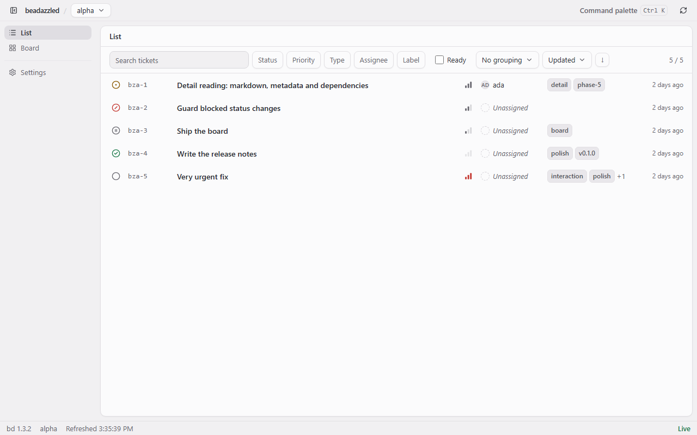
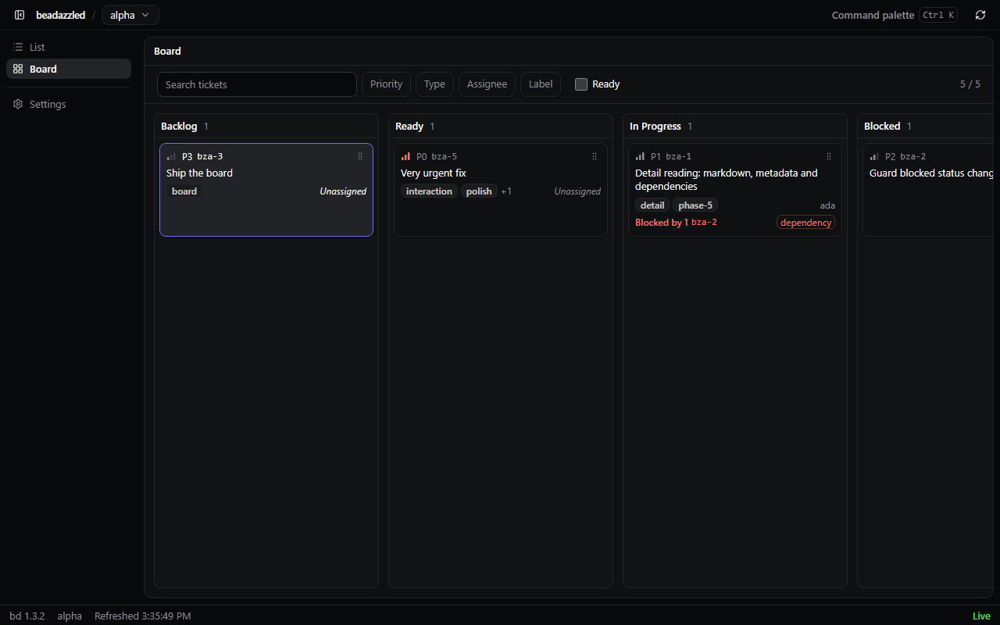
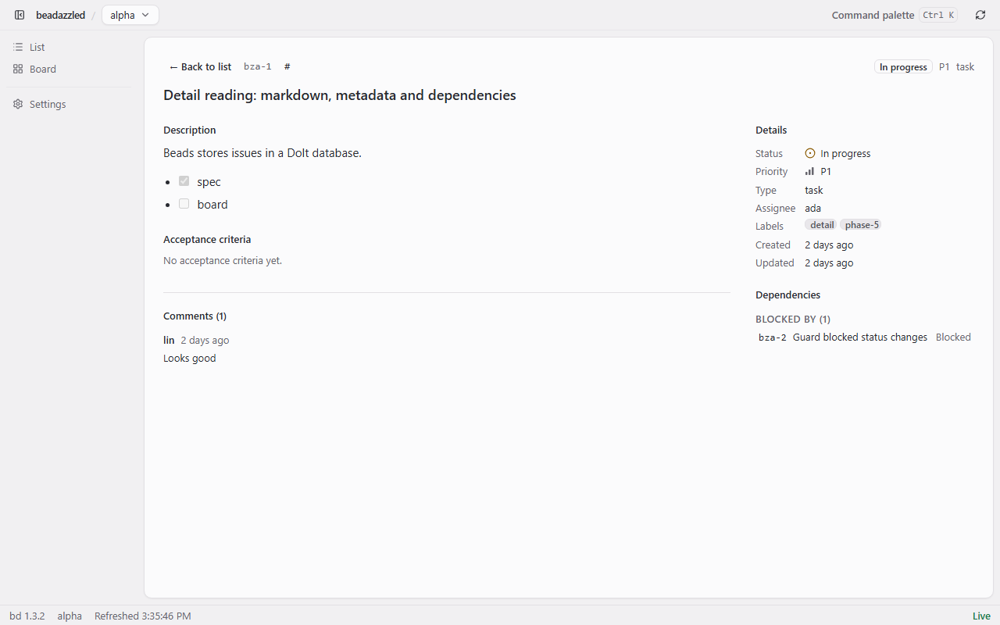

<h1 align="center">beadazzled</h1>

<p align="center">
  <b>A Windows desktop client for the <a href="https://github.com/gastownhall/beads"><code>bd</code></a> CLI</b><br>
  Linear-grade reading and editing for your issue tracker.
</p>

<p align="center">
  <a href="https://github.com/steven123397/beadazzled/releases"></a>
  <a href="https://github.com/steven123397/beadazzled/actions/workflows/ci.yml"></a>
  <a href="LICENSE"></a>
  
  
  
</p>

<p align="center">
  <a href="README.md">English</a> · <a href="README.zh-CN.md">简体中文</a>
</p>

<p align="center">
  
</p>

## Features

- 🗂️ **List** — virtualised for 1000+ tickets, with filters, grouping, saved views and
  J/K navigation.
- 🧱 **Board** — derived columns, keyboard move, blockers visible on the card.
- 📖 **Detail** — Markdown body, acceptance criteria and comments read like documents;
  metadata, dependencies and comments are editable; status changes are written back
  through `bd`.
- ⌨️ **Keyboard-first** — command palette, deep links to any view, no mouse required.
- 🔄 **Signed updates** — minisign-verified, installed passively, checked once per launch.
- 🔒 **Local only** — talks to `bd` and nothing else: no Dolt access, no background
  service, no network requests beyond the update check.

## Requirements

- Windows 10/11 x64 with the WebView2 Evergreen runtime (present on Windows 11 and most
  Windows 10 installs; the installer can fetch it if missing).
- `bd` **1.3.2 or newer**, on `PATH` or configured in Settings → bd. beadazzled never
  bundles `bd`.

## Install

1. Download the latest setup executable from
   [Releases](https://github.com/steven123397/beadazzled/releases)
   (`beadazzled_0.1.0_x64-setup.exe` as of v0.1.0).
2. Compare its SHA-256 with the value on the release page before running it.
3. Run the installer. It installs per-user into `%LOCALAPPDATA%\beadazzled` and needs no
   administrator rights. Uninstall from Settings → Apps, or with `uninstall.exe` in the
   install folder.

Then add a workspace from the welcome screen or Settings → Workspaces.

### Windows SmartScreen

This build is **not Authenticode-signed**. Windows may show “Unknown publisher” or
“Windows protected your PC” the first time you run it. That warning is expected; this
project does not claim OS-level publisher trust. Check that you downloaded from this
repository's Releases page and that the SHA-256 matches before choosing
**More info → Run anyway**.

Update packages are a separate matter: every update is signed with minisign and is
rejected if the signature does not match the key built into the app.

## Screenshots

**List**


**Board**



**Detail**



## Status

v0.1.0 is the first release. Not included yet: dependency graph, dependency editing,
formulas/molecules/gates, team collaboration, macOS and Linux, and direct Dolt access.
See [docs/releases/v0.1.0.md](docs/releases/v0.1.0.md) for the release notes and known
limitations.

## Development

Prerequisites: Node.js 24, Rust stable (MSVC toolchain), and the Tauri 2 prerequisites
for Windows.

```bash
npm ci
npm run dev            # Tauri window with hot reload
npm run dev:web        # browser only, with a fake bridge

npm run check:fast     # typecheck, lint, version consistency, secrets
npm run test:unit      # Vitest
npm run e2e            # Playwright against the real bundle and a fake bridge
npm run test:rust      # bridge tests
npm run build:app      # signed NSIS installer (needs the release key)
```

The quality contract — budgets, gates and the exceptions that are allowed — lives in
[CONSTRAINTS.md](CONSTRAINTS.md). Architecture decisions are recorded in
[docs/adr](docs/adr).

## License

MIT — see [LICENSE](LICENSE). Third-party attribution, including the projects whose
domain definitions and visual references shaped this app, is in [NOTICE](NOTICE).