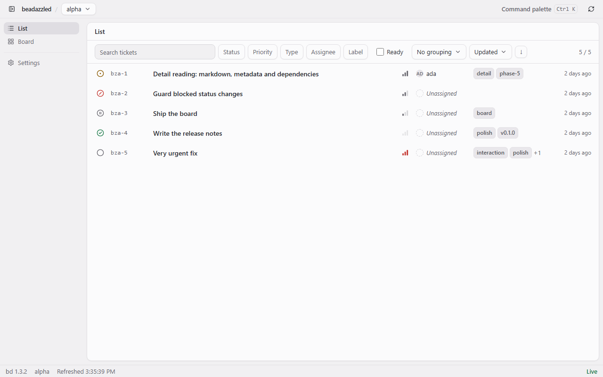
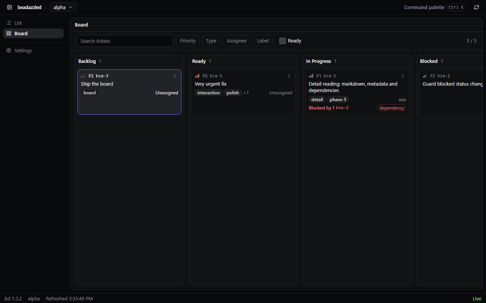
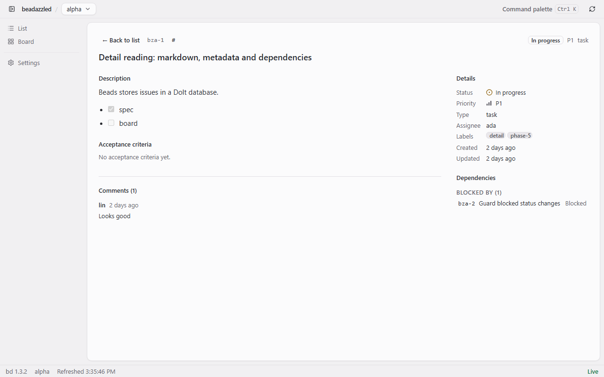

<h1 align="center">beadazzled</h1>

<p align="center">
  <b>面向 <a href="https://github.com/gastownhall/beads"><code>bd</code></a> CLI 的 Windows 桌面客户端</b><br>
  Linear 水准的问题阅读与编辑体验。
</p>

<p align="center">
  <a href="https://github.com/steven123397/beadazzled/releases"></a>
  <a href="https://github.com/steven123397/beadazzled/actions/workflows/ci.yml"></a>
  <a href="LICENSE"></a>
  
  
  
</p>

<p align="center">
  <a href="README.md">English</a> · <a href="README.zh-CN.md">简体中文</a>
</p>

<p align="center">
  
</p>

## 功能

- 🗂️ **List** — 1000+ 条票的虚拟滚动，筛选、分组、保存视图与 J/K 导航。
- 🧱 **Board** — 派生列、键盘移动，卡片上直接看到阻塞项。
- 📖 **Detail** — 正文、验收标准与评论按文档来读；元数据、依赖与评论可编辑，
  状态修改经 `bd` 写回。
- ⌨️ **键盘优先** — 命令面板、可直接分享的深链接，全程不碰鼠标。
- 🔄 **签名更新** — minisign 验签，每次启动检查一次，确认后才安装，安装器会重启应用。
- 🔒 **只在本机** — 只与 `bd` 通信：不打开 Dolt、没有后台服务，除更新检查外不发网络请求。

## 环境要求

- Windows 10/11 x64，带 WebView2 Evergreen 运行时（Windows 11 自带，绝大多数
  Windows 10 也已安装；缺失时安装器可代为下载）。
- `bd` **1.3.2 或更新**，在 `PATH` 中，或在 Settings → bd 里指定。beadazzled 永不捆绑 `bd`。

## 安装

1. 从 [Releases](https://github.com/steven123397/beadazzled/releases) 下载最新的安装包
   （v0.1.0 为 `beadazzled_0.1.0_x64-setup.exe`）。
2. 运行前先对照发布页核对它的 SHA-256。
3. 双击安装。按当前用户装到 `%LOCALAPPDATA%\beadazzled`，不需要管理员权限；
   卸载走「设置 → 应用」，或安装目录里的 `uninstall.exe`。

首次启动后在欢迎页或 Settings → Workspaces 添加工作区。

### Windows SmartScreen

本构建**未做 Authenticode 代码签名**。首次运行时 Windows 可能提示「未知发布者」或
「Windows 已保护你的电脑」。这是预期行为，本项目不宣称已获得系统级发布者信任。
请先确认安装包来自本仓库的 Releases 页面且 SHA-256 一致，再选择
**更多信息 → 仍要运行**。

更新包是另一回事：每次更新都用 minisign 签名，签名与应用内置公钥不符时会被拒绝。

## 截图

**列表**


**看板**



**详情**



## 状态

v0.1.0 是第一个版本。尚未包含：依赖图、依赖编辑、formula/molecule/gate、团队协作、
macOS 与 Linux、直连 Dolt。发布说明与已知限制见
[docs/releases/v0.1.0.md](docs/releases/v0.1.0.md)。

## 开发

前置：Node.js 24、Rust stable（MSVC 工具链）、以及 Windows 上的 Tauri 2 依赖。

```bash
npm ci
npm run dev            # Tauri 窗口，热更新
npm run dev:web        # 仅浏览器，使用 fake bridge

npm run check:fast     # 类型、lint、版本一致、secrets
npm run test:unit      # Vitest
npm run e2e            # Playwright，真实产物 + fake bridge
npm run test:rust      # bridge 测试
npm run build:app      # 签名 NSIS 安装包（需要发布密钥）
```

质量契约（预算、门禁与允许的例外）见 [CONSTRAINTS.md](CONSTRAINTS.md)；
架构决策记录在 [docs/adr](docs/adr)。

## 许可证

MIT，见 [LICENSE](LICENSE)。第三方署名（包括塑造本应用领域定义与视觉参考的项目）
见 [NOTICE](NOTICE)。