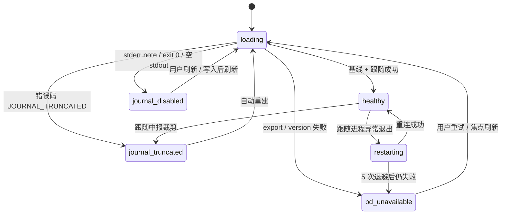

# Spec: sync — 基线与实时增量

状态：v0.1.0 · 依赖：`bridge` · 被 `shell` / `list` / `detail` / `board` 消费

## Objective

保持内存状态与 bd 一致，并把「实时性是否可靠」变成显式状态，而不是让 UI 猜：

- 打开工作区：`bd export` 全量基线，再读 journal 补齐基线期间的变更；
- 之后：`bd events tail --follow --json` 增量跟随；
- journal 关闭 / 被裁剪 / bd 不可用时，进入**可见的降级状态**，绝不静默退回空数据（对照 bv 的反面教材）。

本模块定义事件应用语义与状态机；进程与解析由 `bridge` 提供，写入由 `writes` 触发。

## 状态机



对外暴露：

```ts
export type SyncState =
  | { kind: 'loading'; step: 'export' | 'journal' }
  | { kind: 'healthy'; lastSeq: number; lastEventAt: string | null }
  | { kind: 'journal-disabled' }
  | { kind: 'journal-truncated'; floor: number; recovered: boolean }
  | { kind: 'restarting'; attempt: number }
  | { kind: 'bd-unavailable'; error: BridgeError };
```

UI 映射：healthy → 绿点；journal-disabled / restarting → 黄点 +「实时更新已降级」；journal-truncated → 黄点 +「已重建，可能有间隔」；bd-unavailable → 红点 + 错误信息与「重试」。

## 基线算法（打开 / 显式刷新 / 断档重建共用）

1. **export**：`bridge.export()` 得到完整快照；整体替换 store 的 issue map（保留当前选中 id、筛选与滚动位置）。
2. **journal 补齐**：按检查点 `since` 做一次 `journal(since, follow=false)`：
   - 有检查点且 `project_id` 未变 → `since = 检查点 seq`；
   - 首次打开（无检查点）→ `since = 0`（bd 没有更便宜的「末尾在哪」查询，研究已确认）；
   - 裁剪错误 → 使用错误里的 `floor - 1` 重试一次，并将状态标为 `journal-truncated`（`recovered=true` 表示已用已知间隔续上）；
   - **读取上限（已定）**：一次性读取最多 **50,000 条或 8 秒**（先到者为准）。达到上限不算失败：以已读到的最大 seq 作为跟随起点，剩余积压由 `follow` 继续流入。由于下面的「单调新鲜度」规则，回放旧记录不会把较新的快照状态改回去。
3. **应用**：按 seq 升序应用记录；记录携带的是变更后的完整 issue 状态，因此快照 + 补齐的最终状态一致。
4. **跟随**：以应用到的最大 seq 为 `since` 启动 `journal(maxSeq, follow=true)`。
5. **写入检查点**：每应用一条记录（或每 500ms 合并一次）更新 `{seq, projectId}`，由 `workspace` 持久化。

**显式刷新（Ctrl+R / 状态栏按钮 / 写后刷新）复用同一算法**，不引入第二条数据路径。

## 事件应用语义（纯 reducer）

```ts
export function applyRecord(state: TicketState, record: JournalRecord): TicketState;
```

| op | 行为 |
|---|---|
| `create` / `update` / `close` | `issue` 非空 → 按 id 整体替换（upsert） |
| `delete` | 从 map 删除 |
| `dep_add` / `dep_remove` | 若 `issue` 非空则整体替换；否则仅更新依赖关系 |
| `comment` | 若 `issue` 非空则整体替换；否则按 comment.id 去重后追加 |

规则：
- `seq <= state.lastSeq` 的记录直接丢弃（幂等）。
- **单调新鲜度**：`issue` 只有在 `record.issue.updated_at >= 当前.updated_at` 时才覆盖（时间相同用 seq 决胜）。基线回放历史记录时，旧事件不会把较新的快照状态改回去；`delete` 直接按 id 移除（票 id 不复用，快照中存在而历史中有 delete 的情况不应发生）。
- 检测到 seq 跳跃（journal 契约声明 gapless）→ 视为丢事件，触发一次完整基线，而不是继续拼接。
- 记录乱序到达（不应发生）→ 先按 seq 缓冲再应用。
- 应用后只更新 issue map 与 seq；搜索索引由视图在数据变化时通过 `buildSearchIndex` 全量重建，分组由列表纯函数派生，store 不维护未被读取的派生缓存。1000 条票下 1000 条事件应用 ≤100ms。

## 降级语义

| 状态 | 触发 | 行为 |
|---|---|---|
| `journal-disabled` | `bridge` 返回 `JOURNAL_DISABLED`（stderr note + exit 0 + 空 stdout） | 不启动跟随；写入成功后自动做一次基线；UI 显示「实时更新关闭」；设置页提供开启命令 |
| `journal-truncated` | 首次读取或跟随中返回 `JOURNAL_TRUNCATED` | 自动重建：export → 从 `floor-1` 或 `head` 续读 → 恢复跟随；UI 显示「已重建」 |
| `restarting` | 跟随进程异常退出（bd 崩溃、文件锁、退出码非零） | 250ms / 500ms / 1s / 2s / 4s 退避重连；成功后清零；5 次失败转 `bd-unavailable` |
| `bd-unavailable` | export 失败、版本不符、工作区丢失 | 保留最后一次成功的数据并标注「已过期」；不显示空列表；提供重试 |

**跨机同步已知缺口**：`bd dolt pull` 合入的数据不写 journal（bd 文档明确），v0.1.0 不轮询探测；由显式刷新补齐。状态栏显示「上次刷新时间」，降级状态下窗口重新获得焦点（间隔 ≥60s）时自动刷新一次。

## 写后回声（与 `writes` 的接口）

```ts
// writes 在 bd 写命令成功返回后调用
export async function waitForEcho(issueId: string, afterSeq: number, timeoutMs = 3000): Promise<'echoed' | 'timeout' | 'disabled'>;
```

- healthy：等待该 issue 的 journal 记录出现后返回 `echoed`；超时返回 `timeout`，随后触发一次基线并提示「已保存，视图已刷新」。
- journal-disabled：立即返回 `disabled`；由调用方触发刷新。
- 回声到达前，UI 保持 pending 态（`writes` 负责展示），不做乐观更新。

## Acceptance Criteria

1. **状态可达**：用 fake bridge 可构造并断言全部 6 个状态；状态变化同时推送到 Tauri event 与 store。
2. **基线正确**：fixture「export 快照 + 期间产生的 3 条 journal 记录」应用后，最终 store 与「export 一次到位」的期望一致。
3. **幂等**：同一批记录重复应用两次，store 深度相等；`seq <= lastSeq` 不产生更新事件。
4. **裁剪重建**：首次 `journal` 返回 `JOURNAL_TRUNCATED{floor:50,head:80}` 时，自动从 49 续读、应用 31 条、恢复 healthy，并暴露 `recovered=true`。
5. **关闭识别**：`JOURNAL_DISABLED` 不得被当作「无变更」；状态变为 `journal-disabled`，列表数据仍来自 export。
6. **不可用不静默**：export 失败时 store 不变成空 map；状态含错误码，UI 可渲染错误。
7. **断行缓冲**：跨 chunk 的半个 JSON 行在下个 chunk 补齐后正确解析；EOF 残留半行只告警不崩溃。
8. **重连退避**：跟随进程连续失败 5 次，间隔符合 250/500/1000/2000/4000ms；成功后计数清零。
9. **seq 跳跃**：注入 gap 后触发一次完整基线，而非继续应用。
10. **性能**：1000 条 issue 的 store + 1000 条事件应用 ≤100ms（Vitest 基准，不含渲染）。
11. **交互路径零 bd**：滚动、筛选、切换详情期间 fake bridge 调用计数不增加。
12. **刷新一致**：任意时刻触发刷新，最终 store 与「重启应用后首次基线」的结果一致。
13. **读取上限**：journal 有 60,000 条记录时，一次性读取在第 50,000 条停下并转跟随；最终 store 与全量读取一致，且 no-op 的旧记录不产生可见更新。
14. **新鲜度**：构造「快照 `updated_at` 更新 + 历史旧事件」场景，store 不被旧事件回退（逐字段断言）。

## Module Commands

- `npm run test:unit -- src/lib/sync` — reducer 与状态机测试
- `npm run test:rust` — 基线编排（若放在 Rust 侧）
- `npm run measure:memory`、`npm run measure:startup` — 基线与常驻预算

## Module Structure

```
src-tauri/src/sync/
  baseline.rs      基线编排（export → journal 补齐 → follow）
  follow.rs        跟随进程生命周期、退避、seq 检查
  state.rs         SyncState 与 Tauri event 推送
src/lib/sync/
  reducer.ts       applyRecord（纯函数）
  store.ts         TicketState 与订阅通知
  echo.ts          waitForEcho
tests/fixtures/bd/ export-*.jsonl、events-*.jsonl、truncated-*.json、disabled-*.txt
```

## Module Code Style

- reducer 必须纯函数：`(state, record) => state`，不读时间、不发请求、不写日志。
- 所有 bd 交互只出现在 `src-tauri/src/sync/` 的编排层；TS 层只应用已解析的记录。
- 状态机用穷举 `match` / `switch`，新增状态必须同时补 UI 映射，避免遗漏。

## Boundaries

- **Always**：失败可见；快照与增量共用同一 store 入口；检查点按工作区持久化。
- **Ask first**：引入轮询（任何定时 bd 调用）；改变退避次数或间隔；增加新的事件 op 处理。
- **Never**：把 `JOURNAL_DISABLED` 当空结果；在 healthy 状态下定时调用 bd；用文件监听 `.beads/` 替代 journal；在 UI 层直接拼状态。

## Open Questions

1. **检查点合并粒度**：每条事件写一次配置会造成频繁磁盘写；倾向 500ms 合并 + 应用退出时强制落盘。需在实现时测量写入开销。
2. **`journal-truncated` 恢复起点**：优先用错误里的 `head` 还是 `floor-1`？当前 spec 采用「快照已重建时用 head，否则 floor-1」，实现时以 bd 帮助文本的建议为准。